
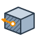

# CutPlane: a live section view for FreeCAD

Click a face to put a cutting plane there, drag the plane through the model with
handles in the 3D view, and watch every cut face appear filled in its part's
colour, hatched and outlined, with clashes between parts in red. The handle
works like the cut tool of PrusaSlicer and OrcaSlicer. CutPlane only changes
what the 3D view draws: your document is never modified.

*One click on the shaft cut this assembly through its axis. The handle on the
left moves and tilts the plane.*

**▶ Video:** [CutPlane at work, in three minutes](https://youtu.be/HC5lY1cs7w4)
(YouTube): placing the plane, the handle, several planes, choosing what is cut,
overlaps, the preferences and how to install it.

## Contents

* [Features](#features)
* [Install](#install)
* [Quick start](#quick-start)
* [Using CutPlane](#using-cutplane)
  * [Turning it on and off](#turning-it-on-and-off)
  * [Placing the plane](#placing-the-plane)
  * [The handle](#the-handle)
  * [Several planes](#several-planes)
  * [Choosing which parts are cut](#choosing-which-parts-are-cut)
  * [Overlaps](#overlaps)
  * [The panel](#the-panel)
  * [Preferences](#preferences)
  * [Pictures, measuring and drawings](#pictures-measuring-and-drawings)
* [Tips and troubleshooting](#tips-and-troubleshooting)
* [How it works](#how-it-works)
* [Limits](#limits)
* [Other ways to see inside a model](#other-ways-to-see-inside-a-model)
* [Development](#development)
* [Credits and licence](#credits-and-licence)

## Features

* **One click places the plane.** Click a flat face, a cylinder, the edge of a
  hole, a vertex, a datum plane or a sketch. Each gives the plane you would
  expect, with no choosing between XY, XZ and YZ first.
* **Handles in the 3D view.** Drag a ball to move the plane and red or green
  arrows to tilt it. It snaps to vertices, edge midpoints and circle centres,
  takes angle steps on a dial, and accepts exact values typed in.
* **Real cut faces.** Each cut face is filled in its part's colour (or one
  colour of your choice), hatched and outlined. Neighbouring parts get
  different hatch angles. The hatch keeps its spacing on screen as you zoom.
* **Overlaps in red.** Where two parts take up the same space, the overlap is
  red and the panel names the pair. Parts that only touch, such as a bearing in
  its seat, are not flagged.
* **Up to three planes** for corner and slab cuts.
* **You choose what is cut.** Cut only some parts, or keep some whole: shafts,
  bolts and balls, the way a drawing shows them.
* **Assemblies just work.** Everything shown is cut:
  * Part and PartDesign objects;
  * `App::Part` containers and links;
  * assemblies and sub-assemblies of the Assembly workbench;
  * meshes, and objects from other workbenches.

  Each part keeps the colour and position it has on screen.
* **Live.** The cut follows the mouse while you drag (about 10–20 ms per update
  on typical models). It also follows your edits: recompute a feature, move a
  part or hide one, and the cut updates.
* **View only.** CutPlane adds nothing to your document, its tree or the undo
  history, so there is nothing to clean up afterwards. Pictures saved with
  Tools ▸ Save Image include the cut faces.
* **In every workbench.** It is on the View menu, the View toolbar, the 3D
  view's right-click menu and Shift+X. The panel is a dock window, so the Tasks
  panel stays free for other tools.

## Install

CutPlane needs **FreeCAD 1.1 or newer**. It uses numpy and shapely, which come
with FreeCAD. It is tested on Linux with FreeCAD 1.1.4. Windows and macOS should
work but have not been tested yet; reports are welcome.

**With the Addon Manager** (once CutPlane is listed in FreeCAD's addon index):
1. Open Tools ▸ Addon manager.
2. Search for *CutPlane* and choose Install.
3. Restart FreeCAD.

Until it is listed, add it as a custom repository first: in Edit ▸ Preferences ▸
Addon Manager, under *Custom repositories*, enter
`https://github.com/toomuchtinkering/CutPlane` with the branch `main`.

**By hand:**

1. Download the [repository](https://github.com/toomuchtinkering/CutPlane) (as a ZIP,
   or with `git clone`) and unpack it.
2. Put the folder into FreeCAD's `Mod` folder and name it `CutPlane`.
   * To find the `Mod` folder, open the Python console (View ▸ Panels ▸ Python
     console) and type `FreeCAD.getUserAppDataDir()`; `Mod` is inside the folder
     it prints.
   * Typical places:

   | System | Mod folder |
   |---|---|
   | Linux | `~/.local/share/FreeCAD/v1-1/Mod` |
   | Linux, Flatpak | `~/.var/app/org.freecad.FreeCAD/data/FreeCAD/v1-1/Mod` |
   | Windows | `%APPDATA%\FreeCAD\v1-1\Mod` |
   | macOS | `~/Library/Application Support/FreeCAD/v1-1/Mod` |

3. Restart FreeCAD. *Section view* now appears in the View menu.

To work on CutPlane itself, link the repository instead of copying it, for
example `ln -s "$PWD" ~/.local/share/FreeCAD/v1-1/Mod/CutPlane` from inside it.

## Quick start

1. Open a model and press **Shift+X** (or choose View ▸ Section view).
2. **Click a face.** The plane moves onto it, and the handle appears where you
   clicked.
3. **Drag the grey ball** into the model. The cut follows the mouse.
4. **Drag a red or green arrow** to tilt the plane.
5. Press **Done** to hide the handle and panel and keep the cut. Press Shift+X
   again to turn it off.

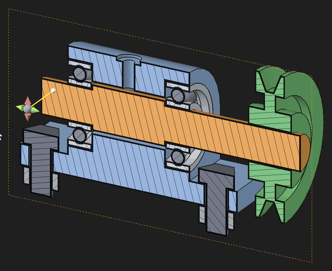

## Using CutPlane

### Turning it on and off

CutPlane adds two commands, in every workbench:

* **Section view** turns the section on and off. Find it on the View menu
  (next to *Clipping plane*), on the View toolbar, in the 3D view's right-click
  menu, and on **Shift+X**. Tools ▸ Customize ▸ Keyboard changes the
  shortcut.
* **Edit section view** (View menu) brings back the panel and handle after
  *Done*.

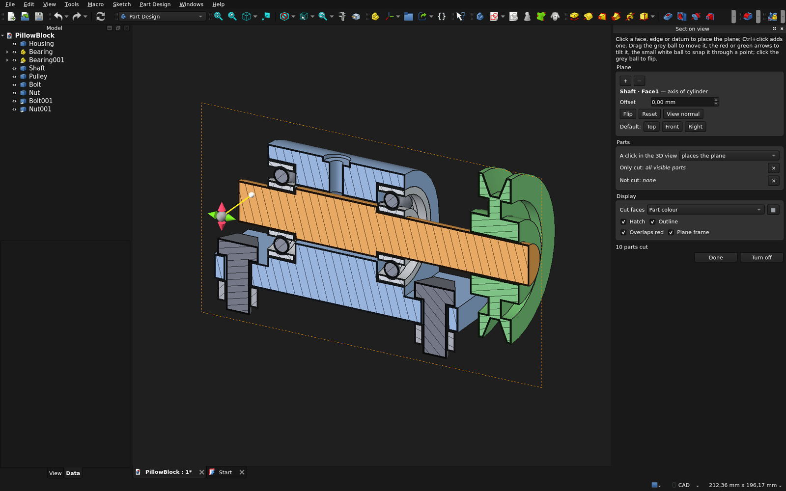

What you have selected when you start decides the first plane:

* **a face, edge or datum:** the plane is placed there, as if you had clicked
  it;
* **whole parts** (in the tree): only those parts are cut;
* **nothing:** the principal plane that faces you best, through the middle of
  the model.

While the panel is open, **a click in the 3D view places the plane; it does
not select anything**. To select, measure or use another tool, press **Done**.
The cut stays, the handle and panel hide, and clicks select again.

**Turn off** in the panel, or Shift+X, ends the section view. Closing the
document ends it too. There is one section view at a time; starting it in
another 3D view moves it there.

### Placing the plane

Click anything in the 3D view; you can also select a datum or sketch in the
tree. The plane then goes where the table says:

| You click | The plane |
|---|---|
| a flat face | lies on the face. The part stays whole until you drag the plane into it. |
| a cylinder, cone, torus or other turned face | goes through its axis, facing you, on the nearest of the part's mid-planes |
| a sphere | goes through its centre, facing you |
| any other curved face | is the tangent plane where you clicked |
| a straight edge or datum line | contains it, facing you |
| a circle or arc | goes through its axis: a cut through the hole |
| a vertex or datum point | moves through it and keeps its direction |
| a datum plane, sketch or coordinate system | is that plane (a coordinate system's XY plane) |

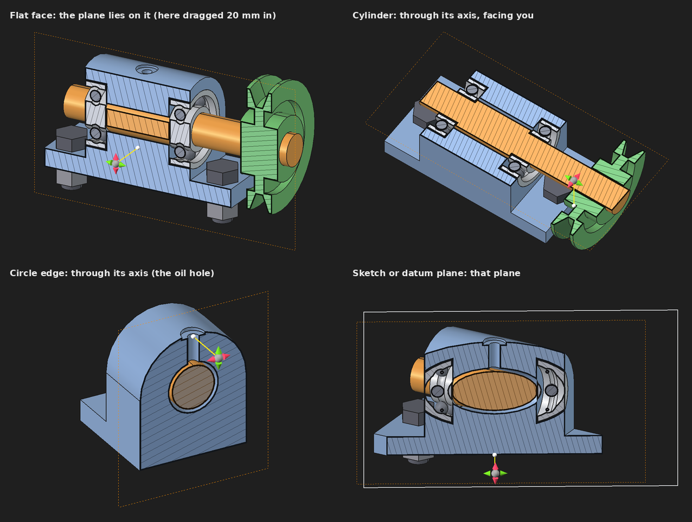

Some rules hold for every click:

* **The side facing you is removed**, so you look at the cut faces. Flip
  changes sides.
* **The handle appears where you clicked.**
* **A click on a cut face does nothing.** Where the model is cut away, a
  click reaches what lies behind the plane.
* **The panel names the plane's source**, for example *Shaft · Face1 — axis of
  cylinder*.

The panel also offers:

* **Top**, **Front** and **Right**: a principal plane through the middle of the
  model, or through the middle of the parts on the *Only cut* list;
* **Reset**: back to where the plane was placed, with no offset or tilt;
* **View normal**: the camera looks straight at the cut.

### The handle

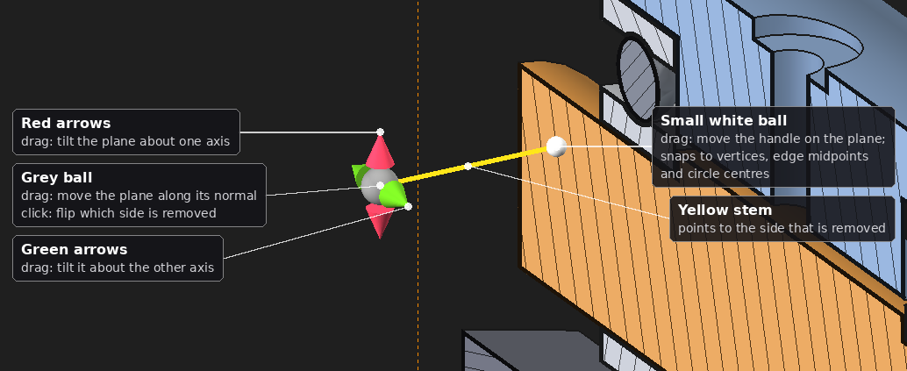

| Part | Drag it to | Click it to |
|---|---|---|
| **grey ball** at the end of the stem | move the plane along its normal | flip which side is removed |
| **red arrows** | tilt the plane about one axis (the ball swings the way the arrows point) | |
| **green arrows** | tilt the plane about the other axis | |
| **small white ball** on the plane | move the handle across the plane; over a vertex, edge midpoint or circle centre it snaps there, and the plane then passes through that point | |

The yellow stem points to the side that is removed. Over the grey ball, the
arrows hide. Over a pair of arrows, the other pair hides, the stem and ball take
the arrows' colour, and a **dial** appears around the plane's centre. While you
tilt, a coloured arc shows the angle.

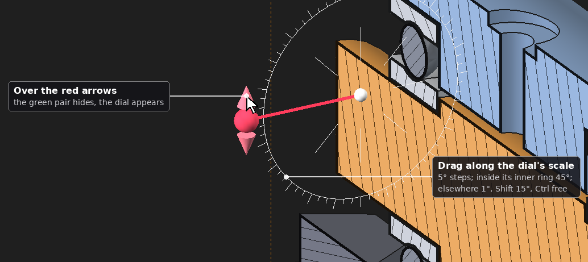

Snapping and steps depend on where the cursor is and on the keys you hold:

| While dragging | grey ball (offset) | arrows (tilt) |
|---|---|---|
| no key | snaps to vertices, edge midpoints and circle centres under the cursor | 1° steps; **5°** with the cursor on the dial's scale; **45°** inside its inner ring |
| **Shift** | whole millimetres | 15° steps |
| **Ctrl** | no snapping | no steps |

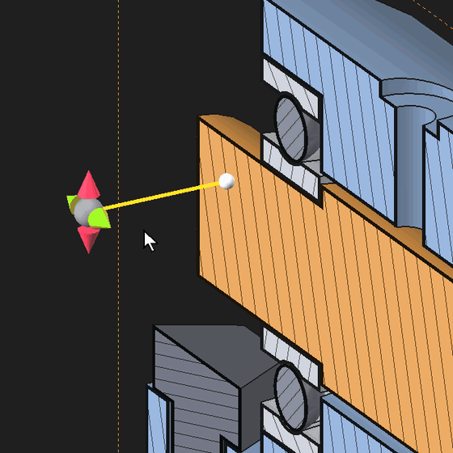

**Tilting** starts from the angle where you grab the arrow, so the plane never
jumps when you press.

**Exact values:** while you drag the grey ball or an arrow, a small field next
to the cursor shows the offset in millimetres or the angle in degrees. Type a
number without letting go: the field takes it, and the plane stops following
the mouse. Press Enter to set it exactly; a decimal comma and a unit are fine
(`-4,5 mm`). An angle counts from where the plane was when you grabbed the
arrow. After the drag, the field stays until your next click, so you can also
click into it and type. **Escape** cancels a drag and puts the plane back. The
panel always shows the offset and tilt of the active plane.

The handle keeps its size on screen however far you zoom. Edit ▸ Preferences ▸
CutPlane sets its size.

### Several planes

* **Ctrl+click** a face to add a plane, up to three. **+** in the panel adds a
  principal plane at right angles to the others.
* The panel's **1**, **2**, **3** buttons choose the plane to edit, and so does
  a click on a plane's grey dot in the 3D view. **−** removes the active plane.
* What remains is the part that every plane keeps. Two planes give a corner or
  a slab; three give a block.

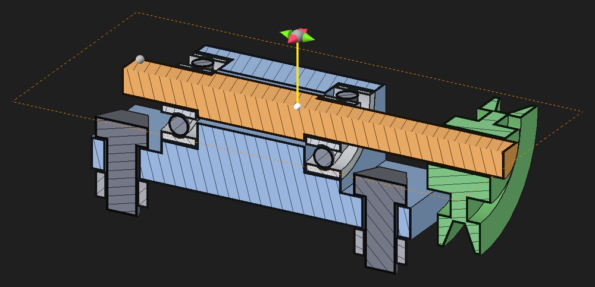

### Choosing which parts are cut

The panel's *A click in the 3D view* list switches what a click does:

* **places the plane** (the default);
* **picks parts to cut:** only the clicked parts are cut;
* **picks parts to keep whole:** the clicked parts are not cut.

A second click on a part takes it off its list again, and **×** empties a list.
Parts that are not cut are drawn whole, not clipped. If you selected whole parts
in the tree before starting, they make up the *Only cut* list.

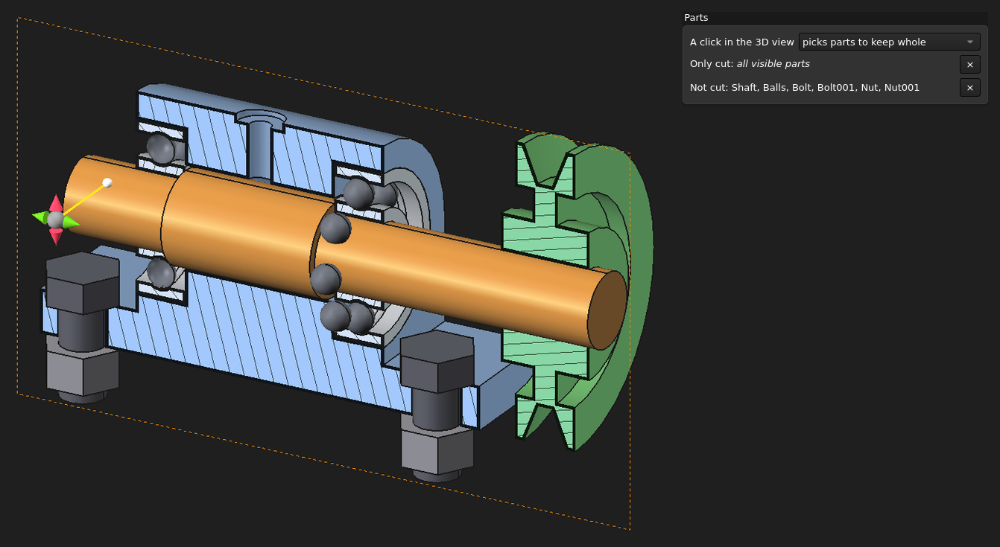

### Overlaps

With **Overlaps red** on, any area where two parts overlap in the cut is drawn
red. The status line at the bottom of the panel names the pairs.

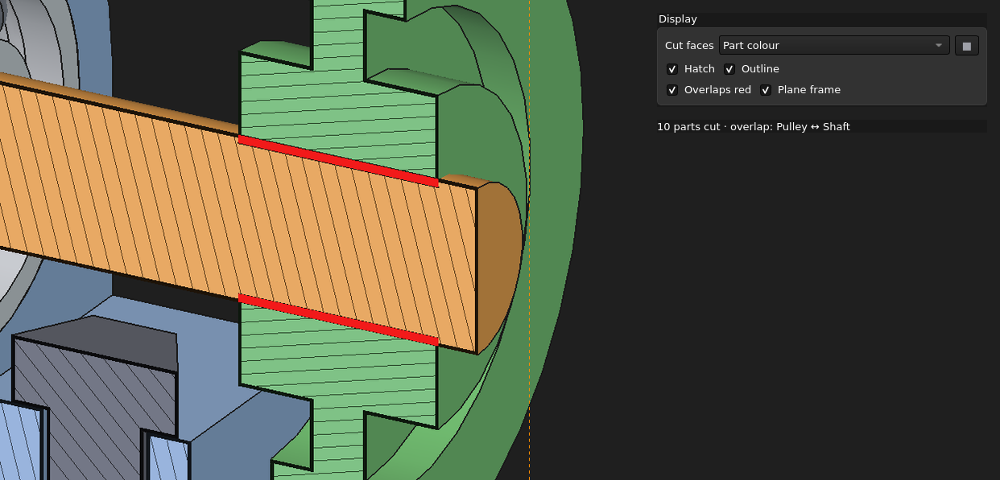

The check works on the same tessellated surfaces FreeCAD displays. Each part is
tessellated within a tolerance of its own: (width + depth + height) / 300 × its
*Deviation* view property, which is 0.5 by default. For a part of 100 × 60 ×
40 mm that is 0.33 mm. This has two consequences:

* **Parts that only touch are not flagged.** Where two parts touch, their
  tessellations overlap in slivers up to one tolerance thick. An overlap only
  counts if it is thicker than about 1.2 × the larger tolerance of the two
  parts. Examples of parts that only touch are a bearing in its seat and a nut
  on its bolt.
* **Smaller interferences are not detected.** A real interference thinner than
  that is ignored as well, because the display mesh cannot tell it from a part
  that only touches.

To see finer, lower the part's Deviation, or the default under Edit ▸
Preferences ▸ Part/Part Design ▸ Shape view. For an exact check, intersect the
two parts with Part ▸ Boolean ▸ Intersection.

### The panel

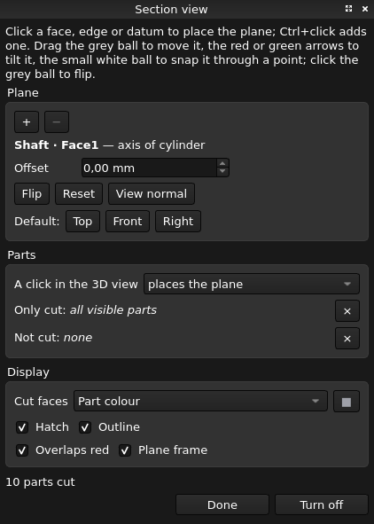

* **Plane**: the planes (**1**–**3**, **+**, **−**) and the source of the active
  one. Below that:
  * **Offset**: the distance from where the plane was placed, along the stem;
    you can type it;
  * the tilt;
  * **Flip**, **Reset**, **View normal**;
  * the **Top**, **Front** and **Right** planes.
* **Parts**: what a click does, and the *Only cut* and *Not cut* lists, each
  with **×** to empty it.
* **Display**:
  * **Cut faces** in *Part colour* or *One colour* (the ■ button picks the
    colour);
  * **Hatch** and **Outline**;
  * **Overlaps red**;
  * **Plane frame**: a dashed outline of the active plane while you edit.
* The **status line**: how many parts are cut, and any overlaps.
* **Done** hides the panel and handle and keeps the cut. **Turn off** ends
  the section view.

The panel remembers its display settings. It is a dock window: drag it to
another side or let it float.

 

### Preferences

**Edit ▸ Preferences ▸ CutPlane** holds the settings that rarely change. An open
section view follows a change at once.

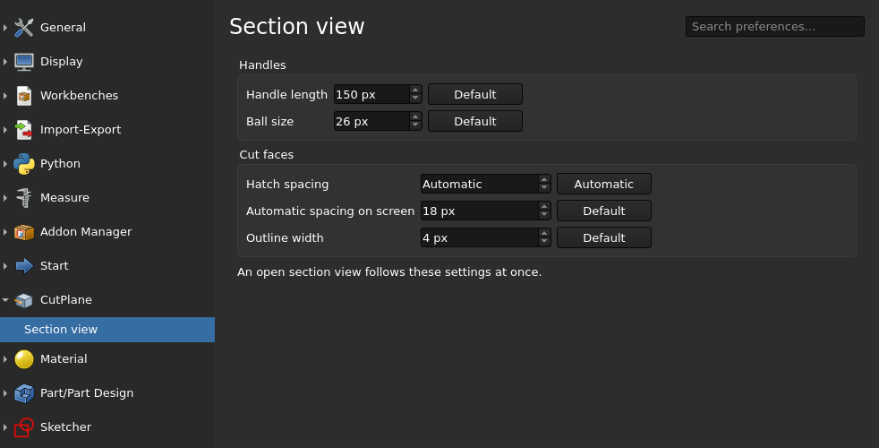

| Setting | Default | What it does |
|---|---|---|
| Handle length | 150 px | length of the stem on screen, from the plane to the grey ball (60–400) |
| Ball size | 26 px | diameter of the grey ball on screen; the arrows scale with it (12–64) |
| Hatch spacing | Automatic | a fixed spacing in millimetres, or Automatic |
| Automatic spacing on screen | 18 px | how far apart the hatch lines are on screen when automatic (6–80) |
| Outline width | 4 px | width of the outline on screen (1–10) |

**Automatic hatch spacing:**
* It is measured across the lines, also on cut faces seen at an angle.
* It is rounded to 1, 1.5, 2, 2.5, 3, 4, 5, 6 or 8 times a power of ten
  millimetres, so the pattern only changes at those steps as you zoom.

**The outline** is a band of triangles just inside each cut face rather than
a wide line. Some graphics drivers, such as VMware's in a virtual machine,
draw every line 1 px wide.

### Pictures, measuring and drawings

* **Pictures:** Tools ▸ Save Image and scripted screenshots include the cut
  faces, because they are real geometry in the scene.
* **Measuring:** press **Done** first, so that clicks select again. You then
  measure on the clipped model; the cut faces themselves cannot be selected.
* **Drawings:** CutPlane is for looking. For section views on a drawing, use
  TechDraw's section views or the BIM workbench's section plane.

## Tips and troubleshooting

**The commands are missing.**
* Check that you have FreeCAD 1.1 or newer.
* Check that the folder in `Mod` is called `CutPlane` and contains
  `package.xml` and a `freecad` folder.
* Check the Report view (View ▸ Panels ▸ Report view) for errors at start-up.
* Check that there is no `ADDON_DISABLED` file in the folder; the Addon Manager
  creates one when you disable an addon.

**Clicking in the 3D view doesn't select anything, or Measure ignores my
clicks.** The panel is open, so clicks place the plane. Press **Done**.

**The wrong side is removed.** Click the grey ball, or press Flip.

**A part looks hollow instead of cut.** Only closed solids get cut faces.
Surfaces, open shells and transparent objects are clipped but not filled. Also
check whether the part is on the *Not cut* list.

**Cut faces on curved parts look faceted.** They follow FreeCAD's display
tessellation, the same facets you see on the part. Lower the part's *Deviation*
view property for a finer one.

**The handle is too small or too big** on your screen: change *Handle length*
and *Ball size* in Edit ▸ Preferences ▸ CutPlane.

**I want an exact position.** Type the offset in the panel, or type into the
field that appears while you drag. You can also snap the small white ball to a
vertex so the plane passes through it exactly.

## How it works

* **Meshes from the scene.** The meshes come straight from the 3D scene, so
  whatever is shown is cut: links, containers, assemblies, meshes and other
  workbenches' objects. Each part's colour, placement and visibility are what
  the screen shows.
* **Clipping on the graphics card.** Clip planes (`SoClipPlane`) cut the
  scene there, so the clipping always follows the mouse at once.
* **Cut faces on the CPU.** The display mesh is sliced (numpy), and the
  outlines with their holes are built and triangulated (shapely and GEOS). The
  hatch is a numpy scanline. Because the cut faces are real geometry in the
  scene, they also appear in saved pictures.
* **Hatch angles and caching.** Neighbouring parts get different hatch angles.
  The cut faces of parts whose outline doesn't change while you drag (most
  prismatic parts) are reused.
* **Speed.** Typical models update in 10–20 ms per drag step. A 400-hole plate
  with 60 more parts (65,000 triangles) takes about 145 ms.

## Limits

* **Accuracy:** the cut follows the display tessellation, so it is exactly as
  accurate as the facets you see. The overlap check has the same limit (see
  [Overlaps](#overlaps)).
* **Only solids are filled:** open shells, surfaces and transparent objects
  are clipped but get no cut faces.
* **Cut-away:** several planes keep only what every plane keeps. A cut-away
  that removes a single corner is not possible yet.
* **Cut faces can't be selected,** so you can't measure on them.
* **Nothing permanent:** CutPlane makes no geometry in the document. For a
  lasting section use Part ▸ Section, TechDraw or BIM.
* **Planes:** at most three.

## Other ways to see inside a model

* **View ▸ Clipping plane** (built into FreeCAD) clips the view with sliders.
  The cut parts look hollow, because there are no cut faces.
* **TechDraw section views and the BIM section plane** are document objects
  meant for drawings.
* **[LiveSectionAnalyzer](https://github.com/sedatkrn/FreeCAD-LiveSectionAnalyzer)**
  is a macro with a live section on the XY, XZ or YZ plane, a slider and a
  gizmo. It can also freeze the section into document objects.

CutPlane is for looking at a model from any plane you click, with several
planes at once, and without touching the document.

## Development

    tests/run_unit.sh                              # geometry core, no FreeCAD needed
    tests/run_gui.sh                               # end-to-end in the FreeCAD GUI on Xvfb
    tests/run_gui.sh tests/gui_test_models.py      # PartDesign, datums, an assembly, heavy models
    tests/run_gui.sh tests/install_check.py        # the installed addon registers its commands
    dev/make_docs.sh                               # remakes the pictures in docs/images

The GUI tests run FreeCAD with your own configuration, but they run with the
default CutPlane settings and put yours back afterwards. They save screenshots
to `dev/out/`. The README pictures come from a demo assembly that
`dev/make_docs.py` builds from Part primitives, so they can be remade after a
change.

The code is in `freecad/CutPlane/`:
* `geom.py`: the pure geometry, unit-tested;
* `session.py`: the section view;
* `gizmo.py`: the handle;
* `panel.py`: the panel;
* `reference.py`: the click rules;
* `scene.py`: reading the 3D scene;
* `render.py`: the nodes drawn.

## Credits and licence

The Qt event filter that sends mouse events to the handle before FreeCAD's
navigation sees them, and the correction for Coin's portrait viewport mapping,
come from the [LiveSectionAnalyzer](https://github.com/sedatkrn/FreeCAD-LiveSectionAnalyzer)
macro by sedatkrn (MIT). The handle follows the cut tool of PrusaSlicer and
OrcaSlicer.

CutPlane is LGPL-2.1-or-later, like FreeCAD (see `LICENSE`). The parts adapted
from LiveSectionAnalyzer (the event filter and the projection helpers in
`gizmo.py`) keep their MIT licence; see `LICENSES/MIT-LiveSectionAnalyzer.txt`.
